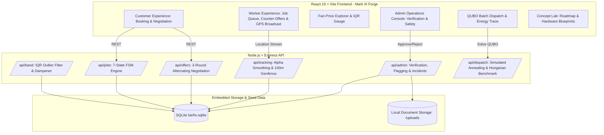

# FairFix: Hyperlocal On-Demand Blue-Collar Services Platform

**Design Architecture: Mark III Forge**  
*Metallic Cockpit Theme &bull; Real-Time Telemetry &bull; Live Price-Band Anti-Gaming*

FairFix is a full-stack, hyper-local on-demand blue-collar services marketplace tailored for urban centers (seeded with Bengaluru neighborhoods: Koramangala, HSR Layout, Indiranagar, Jayanagar, and Whitefield). It solves the dual crises of price gouging and worker exploitation through an automated, dynamic **fair-price band engine**, strict **worker verification workflows**, **live GPS tracking with privacy safeguards**, and a **quantum-inspired QUBO batch dispatch engine**.

---

## 1. System Architecture



---

## 2. Real vs. Stubbed Capabilities (Engineering Truth)

To uphold absolute technical honesty and transparency:

| Component | Status | Real Implementation Details |
| :--- | :--- | :--- |
| **IQR Fair-Price Band Engine** | **REAL** | Computes 25th/75th percentiles from real completed jobs. Filters outliers beyond $1.5 \times \text{IQR}$. Clamps price band shift to $\le 10\%$ per rated job. |
| **Negotiation State Machine** | **REAL** | Enforces strict alternating turn-taking, 3-round maximum limit, out-of-turn blocking, auto-cancellation on round 3 exhaustion, and contact unmasking only upon acceptance. |
| **Document Upload & Admin Queue** | **REAL** | Multer upload validation (JPG, PNG, PDF max 5MB). Admin review modal with approval, rejection with logged reason, and clear error feedback. |
| **3-Customer Auto-Flagging** | **REAL** | Evaluates reports across distinct `reporter_id` customers. 3 distinct customer reports trigger `is_flagged = 1`. Flagged workers rank strictly last in customer discovery. |
| **Safety Incidents & Emergency** | **REAL** | Customer safety incident dispatch with active status tracking and GPS incident logging. |
| **Public Trip Share Link** | **REAL** | Secure tokenized tracking view (`/track/:token`) for third parties with automatic link expiration on job completion. |
| **Live Location Tracking** | **REAL** | HTML5 `watchPosition` GPS ingestion, accuracy filter ($>100\text{m}$ discarded), exponential smoothing ($\alpha = 0.4$), 20-point FIFO cache, and 100m geofence arrival detection. |
| **Pre-Acceptance Privacy Grid** | **REAL** | Truncates worker coordinates to a 500m coarse grid prior to job acceptance, transitioning to exact coordinates only after acceptance. |
| **Quantum-Inspired Batch Dispatch** | **REAL (Classical)** | Classical simulated annealing on an Ising/QUBO Hamiltonian with temperature cooling and 2-opt swaps. Exact Hungarian permutation solver benchmark for $N \le 6$. **(Not run on quantum hardware; no quantum speedup claimed)**. |
| **Concept Lab (D-Wave Hardware, WhatsApp Bot, BLE Wayfinding)** | **STUBBED / ROADMAP** | Strictly non-interactive conceptual blueprint cards with hatched borders, "CONCEPT, NOT IMPLEMENTED" chips, and disabled buttons. |

---

## 3. Algorithmic Mechanics

### A. Dynamic Fair-Price Band & Outlier Filter
1. Historical completed jobs within category and search radius are fetched.
2. The 25th percentile ($Q_1$), 50th percentile (Median), and 75th percentile ($Q_3$) are calculated.
3. Outliers outside $[Q_1 - 1.5 \cdot \text{IQR}, Q_3 + 1.5 \cdot \text{IQR}]$ are removed.
4. If valid sample size $\ge 5$, dampening restricts movement: $\text{Typical}_{\text{new}} \in [0.9 \cdot \text{Typical}_{\text{old}}, 1.1 \cdot \text{Typical}_{\text{old}}]$.
5. Tiered confidence ratings: `high` ($\ge 10$ jobs), `medium` ($5-9$ jobs), `low (few jobs)` ($1-4$ jobs), or baseline `estimate` ($0$ jobs).

### B. Quantum-Inspired QUBO Formulation
The batch assignment problem minimizes the objective Hamiltonian:
$$H(x) = \sum_{i,j} c_{i,j} x_{i,j} + A \sum_i \left( \sum_j x_{i,j} - 1 \right)^2 + A \sum_j \sum_{i < k} x_{i,j} x_{k,j}$$
Where:
- $c_{i,j} = 1.0 \cdot \text{ETA} + 0.5 \cdot |\text{Offer} - \text{Rate}| + 8 \cdot (1 - \text{Rating}/5) + 6 \cdot \mathbb{I}(\text{Unverified})$.
- Penalty $A = 1000$ enforces that every request receives exactly one worker and prevents worker double-booking.
- Evaluated via classical Metropolis-Hastings Markov Chain Monte Carlo with geometric temperature cooling ($T_{\text{init}} = 80$, $\alpha = 0.95$).

---

## 4. Risk Mitigations & Known Limitations

1. **Simulated Annealing Convergence on Large Batches:**
   - *Limitation:* As matrix size exceeds $8 \times 12$ binary variables (96 spins), classical simulated annealing may require higher sweep counts or multiple random restarts to avoid metastable local minima.
   - *Mitigation:* The engine defaults to 3 random restarts and warm starts with greedy feasibility before initiating MCMC exploration.
2. **GPS Inaccuracy in Dense Urban High-Rises:**
   - *Limitation:* Multipath reflections in Bengaluru high-rise societies can produce GPS fixes with $>100\text{m}$ error.
   - *Mitigation:* Fixes with accuracy $>100\text{m}$ are discarded; valid fixes undergo exponential smoothing ($\alpha = 0.4$) to dampen trajectory jitter.
3. **Cash-Only Payment Settlement:**
   - *Limitation:* In-app digital escrow is currently not implemented; all jobs settle via cash on completion.
   - *Mitigation:* Clear in-app warnings and direct unmasking ensure both parties verify cash amounts against the finalized agreed quote before job initiation.

---

## 5. Five-Slide Pitch Deck Text

### Slide 1: The Urban Blue-Collar Crisis
- **Headline:** The Broken Trust in Local Home Services.
- **Problem:** Customers face erratic 2x-3x price gouging during emergencies; gig workers face predatory 20-30% aggregator platform commissions and opaque matching algorithms.
- **Vision:** FairFix creates transparent, hyper-local marketplaces governed by live, tamper-resistant fair-price telemetry.

### Slide 2: The Fair-Price Band Engine
- **Headline:** Price Discovery Driven by Math, Not Aggregator Greed.
- **Mechanism:** Completed neighborhood jobs continuously calculate real-time Interquartile Range (IQR) pricing bands with 1.5x outlier rejection.
- **Impact:** Eliminates arbitrary surge pricing while guaranteeing workers compensation within fair market tolerance.

### Slide 3: Two-Sided Trust & Safety Architecture
- **Headline:** Verification, Privacy & Accountability by Design.
- **Worker Verification:** Admin queue with Aadhaar / trade certificate inspection.
- **Community Shield:** 3 distinct customer reports automatically flag fraudulent workers, relegating them to the bottom of discovery queues.
- **Real-Time Safety:** Live GPS tracking with 500m pre-acceptance privacy masking and emergency incident broadcast.

### Slide 4: Optimization: Quantum-Inspired QUBO Dispatch
- **Headline:** Algorithmic Hyper-Local Batch Matching.
- **Technology:** Formulates city-scale multi-worker assignment as a Quadratic Unconstrained Binary Optimization (QUBO) problem.
- **Execution:** Solved classically via simulated annealing with 2-opt swaps; benchmarked against exact Hungarian algorithm ($N \le 6$) with zero optimality gap on tested small batches.
- **Future Ready:** Formulated for seamless physical embedding onto quantum annealing processors (e.g. D-Wave Advantage).

### Slide 5: The Business & Roadmap
- **Headline:** Scalable, Community-First Unit Economics.
- **Monetization:** Flat ₹15 platform booking fee per completed transaction (vs. predatory 25% aggregator cuts).
- **Roadmap:** Voice-first WhatsApp onboarding for vernacular workers, BLE wayfinding for gated apartment complexes, and physical QPU deployment.

---

## 6. Verification & Test Suite Execution

All unit and integration tests run directly via Node.js / `tsx`:

```bash
# Run all test suites
npx tsx test/band.test.ts
npx tsx test/negotiation.test.ts
npx tsx test/state_machine.test.ts
npx tsx test/step_b.test.ts
npx tsx test/step_c.test.ts
npx tsx test/quantum_dispatch.test.ts

# Run typecheck & build compilation
npm run lint
npm run build
```
